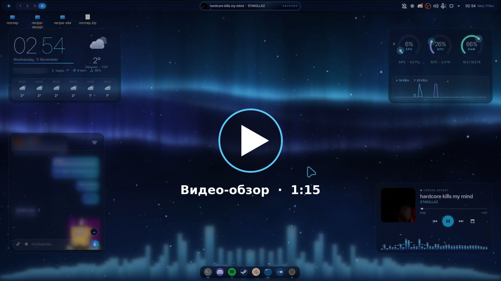
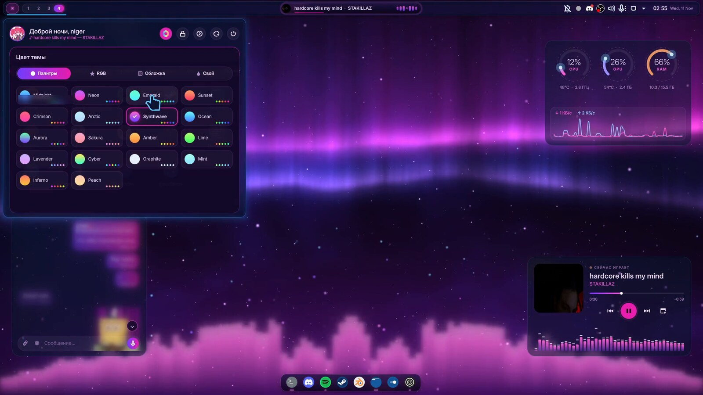

# Midnight Pulse

Анимированная тема для KDE Plasma 6 в глубоком ночном синем. Обои, панель, док и виджеты пульсируют под музыку, а цвет всей темы меняется на лету: 18 палитр, RGB-перелив, цвет обложки трека или свой.

[](https://gerolheld.github.io/MidnightPulse/)

▶ **[Смотреть видео-обзор (1:15)](https://gerolheld.github.io/MidnightPulse/)**: палитры под бит, RGB-перелив, цвет обложки, Dynamic Island, док, рабочие столы.



## Установка

Нужны **KDE Plasma 6** (лучше на Wayland) и **Arch / CachyOS / EndeavourOS / Manjaro**.

```bash
git clone --depth 1 https://github.com/gerolheld/MidnightPulse.git
cd MidnightPulse
./install.sh
```

Установщик сам:

1. ставит нужные пакеты через `pacman` (спросит пароль sudo);
2. собирает аудио-демон и Qt-стиль, скачивает иконки [Tela circle](https://github.com/vinceliuice/Tela-circle-icon-theme) и курсор [Bibata](https://github.com/ful1e5/Bibata_Cursor) и перекрашивает их;
3. **сохраняет твои текущие настройки Plasma** в `~/.local/share/midnight-pulse-backup/`;
4. применяет тему, собирает верхнюю панель и док и расставляет виджеты на рабочем столе;
5. спрашивает город для погоды.

После установки выйди из системы и зайди снова: тогда подхватятся стиль окон, курсор и шрифты.

Параметры: `./install.sh --city "Warszawa"`, `./install.sh --no-deps` (пакеты ставишь сам), `./install.sh --telegram` (см. ниже).

**Вернуть как было:** `scripts/rollback.sh`. Это вернёт прежние панели, виджеты и настройки и остановит службы темы. С `--purge` скрипт ещё и удалит все файлы темы.

Всё ставится в домашнюю папку (`~/.local`, `~/.config`). В систему попадают только пакеты из официальных репозиториев.

## Из чего состоит

| Часть | Где | Что делает |
|---|---|---|
| Аудио-демон | `src/audio/pulsed.cpp` → служба `midnight-pulse-audio` | Слушает Spotify (или звук по умолчанию) через PipeWire и cava, раздаёт спектр, бас и бит всем виджетам по `ws://127.0.0.1:47800` |
| Обои | `org.midnightpulse.sky` | Шейдер: три слоя звёзд, северное сияние, туманность, светлячки, падающие звёзды, эквалайзер у горизонта, текст песни |
| Верхняя панель | `org.midnightpulse.nav`, `.island`, `.clock` + трей | ✦-лаунчер с поиском и категориями, рабочие столы, музыкальный Dynamic Island, часы с календарём |
| Док | `org.midnightpulse.dock` | Увеличение иконок как в macOS, прыжок при запуске, светящиеся индикаторы окон |
| Виджеты | `org.midnightpulse.weather`, `.system`, `.player` | Часы и анимированная погода ([Open-Meteo](https://open-meteo.com), без ключей), кольца CPU/GPU/RAM и сеть, плеер с визуализатором |
| Plasma-стиль, рамки окон | `scripts/gen-desktoptheme.py`, `scripts/gen-aurorae.py` | Стеклянные панели с блюром, светящаяся рамка активного окна |
| Qt-стиль | `src/qt-style` | Стекло в Dolphin, Параметрах, Kate, Ark |
| Глобальная тема | `org.midnightpulse.desktop` | Заставка и экран блокировки с живыми обоями и спектром |
| Иконки, курсор | `scripts/gen-icons.py`, `scripts/recolor-cursors.py` | Стеклянные папки поверх Tela circle, Bibata в цветах темы |
| Терминал | `src/konsole` | Профиль Konsole, fastfetch; цвета для Alacritty и cava |
| Приложения | `src/apps/spicetify`, `src/apps/vesktop` | Темы для Spotify (Spicetify) и Vesktop, по желанию |

## Цвет темы

Нажми ✦ слева сверху, затем радужный кружок в шапке меню. Есть четыре режима:

- **Палитры.** 18 готовых: Midnight, Neon, Emerald, Sunset, Crimson, Arctic, Synthwave, Ocean, Aurora, Sakura, Amber, Lime, Lavender, Cyber, Graphite, Mint, Inferno, Peach. Перекрашивается всё сразу: обои, виджеты, док, стиль Plasma, рамки окон, цветовая схема, курсор, Konsole, cava, Vesktop, Spicetify.
- **RGB.** Плавный перелив по радуге с регулируемой скоростью.
- **Обложка.** Цвет берётся из обложки трека в Spotify.
- **Свой.** Ползунки оттенка и насыщенности.

Как это устроено. Тема задаётся сдвигом оттенка от исходного синего (#1EB0EA, 197°). Демон хранит выбор в `~/.config/midnight-pulse/theme.json` и рассылает его по `ws://127.0.0.1:47800/theme`. `Palette.qml` и шейдер обоев применяют сдвиг на лету, а `scripts/recolor.py` перегенерирует статичные файлы.

## Текст песен на обоях

Если у трека есть синхронизированный текст на [lrclib.net](https://lrclib.net), строки появляются посреди неба:

- слова влетают по одному;
- заливка «поёт» по буквам;
- старая строка уплывает вверх с размытием;
- ниже видна бледная следующая.

Если текста нет, ничего не показывается. На lrclib.net уходят только исполнитель, название, альбом и длительность трека. Выключить: настройки обоев → «Текст песни».

## Spotify и Vesktop (по желанию)

- **Spicetify.** Тема копируется в `~/.config/spicetify/Themes/MidnightPulse`. Включить: `spicetify config current_theme MidnightPulse && spicetify apply`.
- **Vesktop.** Тема лежит в `~/.config/vesktop/themes/`. Включить: Настройки → Themes → MidnightPulse.

## Чат Telegram (по желанию, по умолчанию выключен)

Карточка на рабочем столе с одним личным чатом. Умеет:

- текст, фото, файлы, вставку скриншота по Ctrl+V;
- голосовые, стикеры, реакции, ответы, редактирование.

Бэкенд `src/tg/tgd.py` (Telethon) входит в аккаунт как отдельное устройство «Midnight Pulse widget». Всё хранится только на твоём компьютере, файлы доступны только тебе.

Включить:

```bash
./install.sh --no-deps --telegram    # или: python3 scripts/install.py --telegram --layout
midnight-pulse-tg-login             # api_id/api_hash с my.telegram.org, вход по QR
```

Отключить доступ: Telegram → Настройки → Устройства → Midnight Pulse widget.

## Запись экрана

`scripts/chat-privacy.sh on` размывает ленту сообщений в карточке Telegram (шапка и поле ввода остаются), `off` возвращает как было. Пока размытие включено, наведение на карточку не отмечает сообщения прочитанными.

## Производительность

`Occlusion.qml` следит за окнами. Когда рабочий стол закрыт полноэкранным или развёрнутым окном (игра, браузер), обои и виджеты засыпают. В игре plasmashell тратит около 6% CPU.

## Для разработки

```bash
python3 scripts/install.py              # скопировать изменения и применить настройки
python3 scripts/install.py --layout     # + пересобрать панели и виджеты
python3 scripts/install.py --build      # пересобрать демон, Qt-стиль, иконки, курсор
scripts/install-packages.sh && systemctl --user restart plasma-plasmashell   # только QML-виджеты
/usr/lib/qt6/bin/qsb --glsl "100es,120,150" --hlsl 50 --msl 12 \
  -o src/wallpaper/org.midnightpulse.sky/contents/shaders/sky.frag.qsb src/wallpaper/sky.frag
```

Общие QML-файлы лежат в `src/common/`. При установке они копируются в каждый виджет как `contents/ui/common`.

## Лицензия

MIT, см. [LICENSE](LICENSE). Исключение: файлы экрана блокировки в `src/plasma/look-and-feel/org.midnightpulse.desktop/contents/lockscreen/` основаны на коде KDE Plasma и остаются под лицензиями из их заголовков (GPL-2.0-or-later / LGPL-2.0-or-later). Иконки Tela circle и курсор Bibata не входят в репозиторий: установщик скачивает их с GitHub авторов (GPL-3.0).
